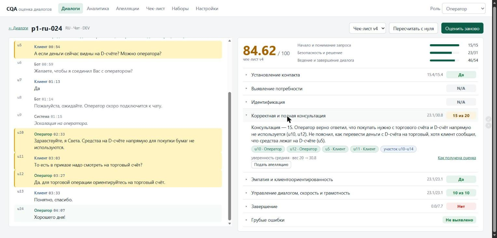
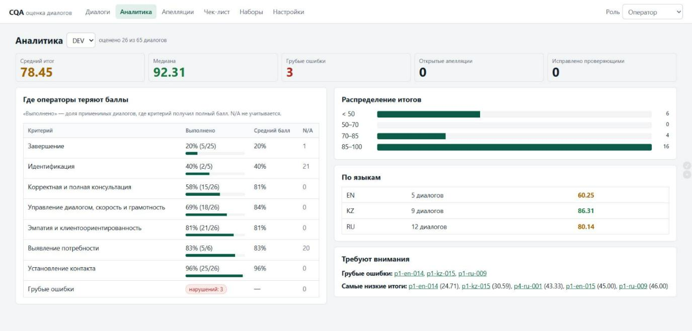
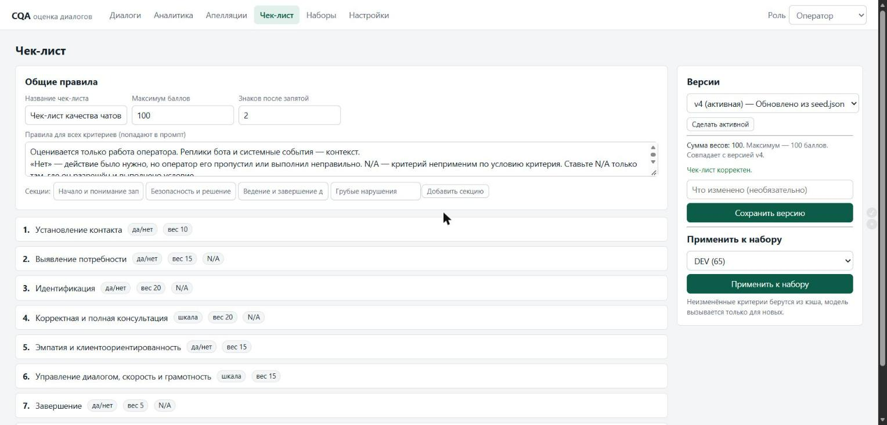
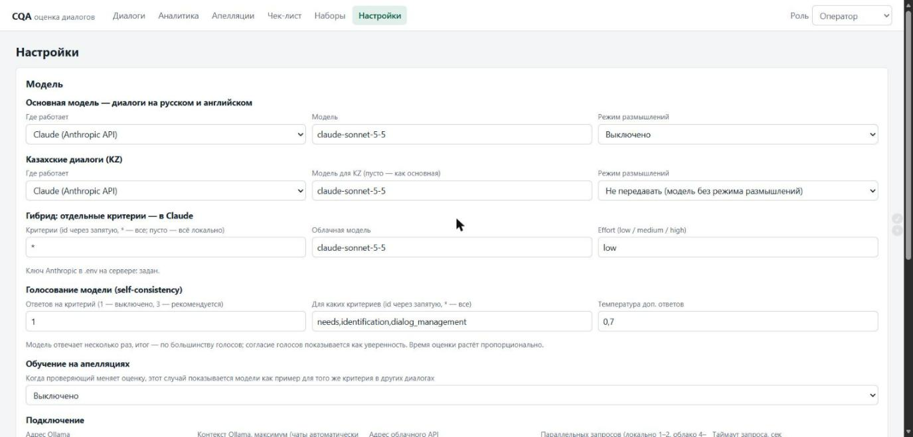
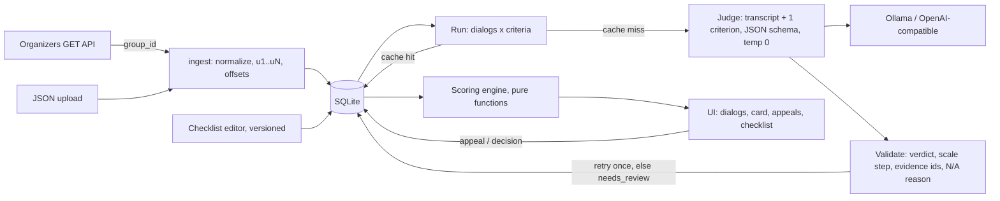

# CQA — Conversation Quality Analytics

**Team Avivengers** · Freedom Broker CQA hackathon (NU Data Challenge'26) · Yerassyl Tulegen, Mansur

| Mode (same pipeline, switch in **Настройки**) | Holdout (8 dialogs) | Full gold (26 dialogs, 208 labels) | Cost per dialog | Data leaves the server |
|---|---|---|---|---|
| **Local**: qwen3:8b (RU/EN) + Sherkala 8B (KZ) on one RTX 4060 | **81.2%** | ~72% | **$0** | no |
| **Hybrid / cloud**: Claude Sonnet 5.5 for the routed criteria | **93.8%** | **95.7%** (κ 0.945) | ~$0.04 | routed criteria only |

Local: final overnight-loop rules (round 9, `6537b95`); Claude: re-checked on the final loop rules (round 13,
checklist v4), holdout unchanged at 93.8%. All numbers are against our hand-labelled gold set (26 DEV dialogs,
208 labels; Cohen's κ 0.945 full gold, 0.921 holdout). Details and rejected experiments: [Validation](#validation-against-human-labels).

**What is different here**

- **A small local model that is actually measured.** qwen3:8b + the Kazakh-specialised Sherkala 8B on one laptop
  RTX 4060 reach **81.2%** on a holdout the rules were never tuned on, at $0 and with no data leaving the bank.
  The rules behind it were tuned in 13 automatic keep/revert rounds (5 kept), each judged on a TUNE set and checked on the holdout.
- **The same pipeline, one switch away from the cloud.** Any subset of criteria can be routed to Claude Sonnet 5.5
  (Настройки → Гибрид); with all criteria routed it reaches 93.8% holdout / 95.7% full gold at ~$0.04 per dialog.
  A bank picks per criterion between privacy and accuracy.
- **Numbers you can check.** `python -m eval.run_eval` prints per-criterion accuracy, κ, scale MAE, per-language
  accuracy and every disagreement with a deep link. Experiments that did not pay off (voting, LoRA, Fable, higher effort)
  are kept in the table below with the reason they were dropped.

| Dialog card: verdict, points, explanation, evidence lines | Analytics for a QA manager |
|---|---|
|  |  |
| **Checklist editor with versions, apply to a set** | **Settings: local / hybrid / cloud per criterion** |
|  |  |

**Кратко (RU).** Система оценки качества работы операторов Freedom Broker по чек-листу. Загружает диалоги
по `group_id` из API организаторов, оценивает каждый критерий LLM — **локально** (qwen3:8b для RU/EN,
казахская модель Sherkala для KZ, $0 за оценку на одной RTX 4060) или **гибридно**: выбранные критерии
уходят в Claude Sonnet 5.5 (переключается в Настройках по каждому критерию), показывает ответ, баллы, вес,
обоснование и **ссылку на конкретную реплику**; при N/A объясняет причину. Апелляция и решение
проверяющего пересчитывают итог, исходная оценка ИИ сохраняется. Чек-лист редактируется в интерфейсе,
каждая версия сохраняется, при применении пересчитываются только изменённые критерии.
Результаты для организаторов: `results/dev/results.json`, `results/prod/results.json` (формат 1.0).

**Попробовать без GPU:** в `.env` укажите `LLM_PROVIDER=fake` — интерфейс работает полностью,
оценки ставит тестовый провайдер.

Prototype for the Freedom Broker CQA hackathon. It scores how operators handle customer chats and calls
against a configurable checklist, shows the answer, points, weight, explanation and the exact message
behind every criterion, and supports appeals with a reviewer decision and recalculated total.

- **Local LLM judge** (Ollama, default `qwen3:8b`) with an OpenAI-compatible cloud fallback.
- **Per-criterion hybrid routing**: list criteria in **Настройки → Гибрид** and only those go to Claude
  (official Anthropic SDK, structured JSON output, transcript prompt-cached across the 8 criteria); the rest
  stay local. A bank can run fully on-prem for privacy or route the hard judgment calls to the cloud for accuracy.
  `results.json` reports the mode (`local` / `hybrid` / `external_api`) from the calls actually made.
- **One model call per (dialog, criterion)**, evidence cited by utterance id and validated on the server.
- **All arithmetic is deterministic Python** (weights, N/A redistribution, rounding), unit-tested.
- **Checklist editable in the UI**, every save is a new version; re-applying re-runs only changed criteria.
- **Kazakh dialogs go to a Kazakh-specialised model** (Sherkala), RU/EN to qwen3 — all local, $0 per evaluation.
- **Learning from appeals**: when a reviewer changes an AI score, that case becomes an example for the same
  criterion in other dialogs (never in its own dialog; toggle in Настройки).
- **Аналитика**: set-level view for a QA manager — score distribution, where operators lose points,
  gross-error dialogs, per-language averages.
- **Results export** in the organizers' format 1.0: `python -m eval.export_results --group <id>` →
  `results/dev|prod/results.json` (also a button on Наборы).

## Run (Python 3.11+)

```bash
python -m venv .venv && .venv\Scripts\activate      # macOS/Linux: source .venv/bin/activate
pip install -r requirements.txt
copy .env.example .env                               # macOS/Linux: cp — then fill it in
python -m uvicorn app.main:app --port 8000
```

Open http://localhost:8000. Tests: `python -m pytest -q`.

Local model setup (Ollama on an RTX 4060 laptop): [docs/SETUP_4060.md](docs/SETUP_4060.md).

### Environment (`.env`)

| Variable | Meaning |
|---|---|
| `CQA_API_URL_TEMPLATE` | Organizers' GET link with `{group_id}` in place of the group id. Keep it out of git. |
| `LLM_PROVIDER` | `ollama` (local), `openai` (any OpenAI-compatible API), `fake` (tests/offline UI) |
| `LLM_MODEL` | e.g. `qwen3:8b` |
| `OLLAMA_URL`, `OLLAMA_NUM_CTX`, `OLLAMA_THINK` | Ollama address, context size, thinking mode for qwen3 |
| `OPENAI_BASE_URL`, `OPENAI_API_KEY` | Cloud fallback; the key never leaves the server |
| `ANTHROPIC_API_KEY` | Claude key for hybrid mode; server-side only, never in the DB or UI |
| `ROUTE_CRITERIA`, `ROUTE_MODEL`, `CLAUDE_EFFORT` | Criteria sent to Claude (ids, comma-separated, `*` = all, empty = fully local), model (`claude-sonnet-5-5`), effort (`low`) |
| `LLM_CONCURRENCY`, `LLM_TIMEOUT_S` | Parallel model calls, per-call timeout |
| `CORS_ORIGINS` | Allowed origins for a future Dynamics 365 host |

Provider, model, Ollama address and concurrency can also be changed at runtime in **Настройки**
(stored in the DB), so switching models needs no code change after stop-code.

## Import data and evaluate (all through the UI)

1. **Наборы** → enter `group_id` (e.g. `DEV`, or the control id) → **Загрузить**. The server fetches it (no CORS issues)
   and shows an import report. A JSON file (full API response, array, or one record) can be uploaded instead.
2. **Оценить** next to the set → progress shows done / cache hits / new model calls / needs review.
3. **Диалоги** → open a dialog: transcript on the left, results on the right. Evidence chips jump to the
   message (and seek the call recording). `#/dialog/<id>?u=u12` is a deep link to a message.

## Model and cost

| Model | Used for | Where | Cost per evaluation (8 calls) | Latency per call p50 / p95 | Invalid first answers | Full DEV run |
|---|---|---|---|---|---|---|
| `qwen3:8b` (Q4, Ollama) | RU + EN (50 dialogs) | local RTX 4060 8 GB | **$0** (electricity only) | 9.9 s / 16.7 s | 0.2% | 72 min (400 calls) |
| `sherkala` (Llama-3.1-Sherkala-8B, Q4_K_M) | KZ (15 dialogs) | local RTX 4060 8 GB | **$0** | 4.3 s / 6.0 s | 8.5% (fixed on retry) | 10 min (120 calls) |
| `claude-sonnet-5-5` (effort `low`) | routed criteria, all languages | Anthropic API | **~$0.04** (26 gold dialogs = $1.08) | ~10 s | 0% | ~4 min for 26 dialogs at concurrency 4 |

Full DEV (65 dialogs × 8 criteria): **~82 min**, invalid outputs 2.0%, «требует проверки» 0.17% (1 of 520).
One evaluation uses ~16k input and ~2k output tokens. Measured 2026-11-07, checklist v2, `LLM_CONCURRENCY=1`.

Cost and tokens are logged for every call (`llm_calls` table); **Настройки → Стоимость и надёжность** shows the
average cost per evaluation, tokens per dialog, p50/p95 latency and invalid-output rate. For a paid model, add
its price per 1M tokens to `config/prices.json` and the UI shows real cost.

## How it works



- **Prompt layout**: system rules → transcript with ids `[u7] 00:41 operator: …` → one criterion block (rules,
  answer definitions, scale steps, N/A condition) → JSON. The transcript prefix is identical across criteria,
  so Ollama reuses its KV cache.
- **Output** (reasoning before verdict): `reasoning, verdict, value, evidence_ids, checked_range, na_reason, explanation, confidence`.
  Ollama's structured output constrains verdicts, scale steps and utterance ids to valid values.
- **Validation**: verdict allowed for the criterion, value is a listed step, N/A only when allowed and explained,
  evidence ids exist, a "yes" cites an operator line. On failure: one retry with the error, then `needs_review`
  (shown as «требует проверки», excluded from the total, which is marked provisional).
- **Cache**: `sha256(transcript, criterion + rules, prompt version, provider, model)`. Editing one criterion
  re-runs only that criterion; a new transcript always gets a fresh evaluation.
- **Appeals**: original AI results are never modified. Appeals and decisions are separate records;
  final = reviewer decision if changed, else original; totals are recomputed from final values.

### Scoring rules (from the checklist PDF)

- Да = full weight, Нет = 0; scale criteria proportional to the weight, top step = full weight.
- N/A criteria are excluded and their weight is redistributed proportionally; the maximum stays 100.
- Total rounded to 2 digits (HALF_UP). No applicable weighted criteria → total is not computed.
- Gross errors are a separate flag with no points and do not change the total.

## Validation against human labels

```bash
python -m eval.make_gold        # drafts eval/gold/gold_labels.csv from model results (stratified RU/KZ/EN + calls)
# annotators fix `value` and put their name in `annotator`
python -m eval.run_eval         # accuracy, Cohen's kappa, scale MAE, per-language, total-score error, disagreements
```

To compare models: switch the model in **Настройки**, run DEV again, run `eval.run_eval`. Results for each model
stay cached, so switching back is instant.

Results on the team gold set (13 DEV dialogs, 104 labels: 4 RU, 4 KZ, 4 EN, 1 call; qwen3:8b for RU/EN, sherkala for KZ):

| Checklist | Accuracy | Kappa | Total-score MAE | RU | KZ | EN | Weakest criteria |
|---|---|---|---|---|---|---|---|
| v2 (team rulings, `1779644`) | **71.2%** | 0.629 | 17.0 pts | 77.5% | 75.0% | 59.4% | needs 15%, identification 62%, dialog management 62% |
| v3 (organizers' answers + step-by-step rules, `76cfb00`) | 67.3% | 0.582 | 25.4 pts | 70.0% | 62.5% | 68.8% | needs 38%, contact 54%, identification 54% |

v3 fixed EN and needs but made contact (model often says "no greeting/intro in the first reply") and KZ
identification/closing worse. Per-dialog disagreements: `python -m eval.run_eval` → `eval/reports/`.

### Experiments on the final gold set (2026-11-07)

Gold = 26 DEV dialogs, 208 labels. **Holdout** = 8 of them never used for training or prompt tuning
(`p1-ru-001/013/028/024`, `p1-en-011/015`, `p1-kz-007/014`), 64 labels. KZ always on `sherkala`.

| Setup (RU/EN judge) | Holdout | Full gold | Decision |
|---|---|---|---|
| Checklist v4, prompted `qwen3:8b` | 76.6% | 65.9% | baseline |
| v4 + self-consistency voting k=3 (needs, identification, dialog management) | 73.4% | 64.4% | **off** — worse, and 10 chats ≈ 24 min (> 20 min budget) |
| v4, LoRA fine-tune `qwen3-cqa` (Q4_K_M in Ollama) | 78.1% | 70.2%* | **not used** — +1.5 on holdout, below the +3 bar |
| **Checklist rules-v5, prompted `qwen3:8b`** | **76.6%** | **69.7%** | **adopted** (`7b13e60`) |

| Overnight keep/revert loop, round 9 rules (`6537b95`), prompted `qwen3:8b` | **81.2%** | ~72% (TUNE 72.2%) | **adopted for local mode** |
| **Round-4 rules (`15d6239`), Claude Sonnet 5.5 (effort low) on all criteria** | **93.8%** | **95.7%** | **adopted for hybrid** (2026-11-08) |
| Sonnet 5.5, effort `medium`, consultation only | — | 84.6% (same as low) | **not used** — the same 4 dialogs differ |
| Claude Fable 5.1 (5× the price) | not run | — | **skipped** — remaining misses don't move with more thinking (see below) |

\* Inflated: 10 of the 26 gold dialogs were in the fine-tune's training data; only the holdout is a fair test.

**Sonnet per criterion (full gold):** contact, needs, identification, gross errors 100%; closing 96.2%;
empathy 92.3%; dialog management 92.3%; consultation 84.6%. Per language: KZ 98.6%, EN 97.5%, RU 92.7%.
Of the 9 remaining disagreements, 3 are consultation 20 (ours) vs 15 (model), where the model names a real
minor gap (e.g. no instruction to move money from the D-счёт to the trading account). That matches the PDF's
15 step, so these look like lenient gold labels rather than model errors; raising effort did not change them,
which is why a bigger model was not worth 5× the price.

Local qwen per criterion (overnight loop, TUNE set): contact 100%, gross errors ~89–100%, closing ~78%,
empathy ~78%, dialog management ~67%, identification ~67%, consultation ~56–61%, needs ~44%. A sensible
hybrid keeps contact and gross errors local and routes the other six to Claude.
rules-v5 fixes were derived from the full-gold v4 disagreements, so part of its +3.8 is tuning; the unchanged
holdout is the clean signal.

**Fine-tune details** (branch `sft`, see `eval/CHANGELOG.md` there): QLoRA (Unsloth) on Qwen3-8B, r=16, 2 epochs,
288 examples from 36 DEV chats (8 gold + 28 agent-labelled silver, `eval/gold/silver_labels.csv`), 46 min on the
RTX 4060. Same-runtime control (untrained base): 65.6% vs 79.7% trained, so training itself helps, but after
Q4_K_M quantization in Ollama the gain over the prompted model shrinks to 1 label. To try it: build the GGUF as in
the changelog, `ollama create qwen3-cqa`, then pick it in **Настройки**. No code change.

## Demo-day runbook

**Before stop-code**: fresh clone → setup → run → load DEV → evaluate → tag the commit.

**At hour 23**: Наборы → control `group_id` → Загрузить → Оценить → wait for progress to finish.

**Context size**: for the chats-only control set keep **Настройки → Контекст Ollama = 8192** (chat prompts are
≤ 3k tokens): qwen3 then fits fully in the 8 GB GPU, runs faster and doesn't push ~11 GB into system RAM.
Set it back to **12288** before any DEV run, because call prompts reach ~7.7k tokens.

**Criterion swap**: Чек-лист → edit/replace the criterion → **Сохранить версию** → **Применить к набору** → the control
set. Progress shows cache hits for unchanged criteria and new calls only for the changed one.

**Pre-pick demo dialogs**: one with crisp evidence, one with N/A, one with a gross error if any, one call (audio seek).

**Hybrid for the control set**: **Настройки → Гибрид** → criteria `needs,identification,consultation,empathy,dialog_management,closing`
(or `*` when the 4060 is unavailable — Claude needs no GPU), effort `low`; turn learning from appeals off.

**Fallback**: results survive restarts (SQLite in `data/`). If the local model fails, switch the provider in
**Настройки** (or `.env` + restart) — not a code change.

## Dynamics 365 adaptation

- `frontend/` is plain HTML/CSS/ES modules with relative paths, no build step and no CDN: upload the files as
  web resources under the publisher prefix.
- Pass the backend address via the `data` parameter (`apiBase=https://…` or `{"apiBase":"https://…"}`), or `?apiBase=`.
- All state lives in the backend, so the control can be reloaded by the form at any time.
- Add the D365 org origin to `CORS_ORIGINS`.

## Known limitations

- Transcript-only judging: tone and diction in calls are not assessed (the checklist has no audio criteria).
- Small local models are weaker in Kazakh, so KZ dialogs go to Sherkala; check per-language accuracy in the eval report.
- On the 8 GB 4060, qwen3:8b at `OLLAMA_NUM_CTX=12288` runs ~13% on CPU (7.2 GB). The longest DEV prompt is
  ~7.7k tokens, so the context can't drop to 8k without cutting long dialogs.
- The gold set is small (26 dialogs, 8 in the holdout) and labelled by our team, so accuracy numbers have wide
  error bars and may differ from the organizers' Ground Truth.
- Hybrid mode sends the transcripts of routed criteria to the Anthropic API; for fully on-prem use leave
  `ROUTE_CRITERIA` empty.
- Next step (not done): distil Claude's verdicts and reasoning into the local model (LoRA on qwen) so the
  on-prem mode closes the gap without sending data out.

Open questions and interpretations: [docs/OPEN_QUESTIONS.md](docs/OPEN_QUESTIONS.md).
