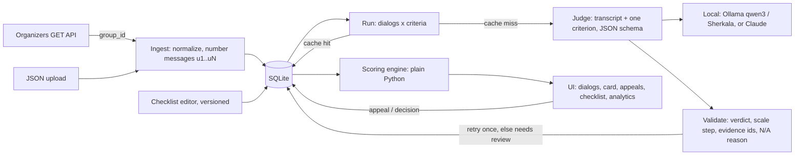

# CQA — Conversation Quality Analytics

**Team Avivengers** · Freedom Broker CQA hackathon (NU Data Challenge'26) · Yerassyl Tulegen, Mansur

**Кратко.** Система оценивает работу операторов Freedom Broker по чек-листу из 8 критериев — в чатах и
звонках на русском, казахском и английском. По каждому критерию: ответ, баллы, вес, обоснование и
**ссылка на конкретную реплику**; при N/A — причина. Итог считается кодом строго по чек-листу.
Оператор подаёт апелляцию, проверяющий подтверждает или меняет оценку — итог пересчитывается, исходная
оценка ИИ сохраняется. Чек-лист редактируется в интерфейсе: каждая версия сохраняется, при применении
пересчитываются только изменённые критерии. Модель переключается в Настройках: **полностью локально**
(данные не покидают банк) или **Claude** для максимальной точности — по каждому критерию отдельно.


## Results at a glance

| Mode (same pipeline, one setting) | Holdout, 8 dialogs | All labelled, 26 dialogs | Cost per dialog | Data leaves the bank |
|---|---|---|---|---|
| **Local**: qwen3 8B (RU/EN) + Kazakh Sherkala 8B, one laptop RTX 4060 | **81.2%** | ~72% | **$0** | no |
| **Cloud**: Claude Sonnet 5.5 | **93.8%** | **95.7%**, Cohen's κ 0.945 | ~$0.04 | yes (routed criteria only) |

Accuracy = per-criterion agreement with our hand-labelled DEV dialogs (208 labels). The **holdout** dialogs were
never used to tune rules, so that column is the honest estimate. Kazakh with Claude: 98.6%.

**Submitted files** (format 1.0, team `Avivengers`):

| File | Set | Model |
|---|---|---|
| [`results/prod/results.json`](results/prod/results.json) | control set `FBroker`, 10 chats | Claude Sonnet 5.5, checklist v4 |
| [`results/dev/results.json`](results/dev/results.json) | DEV, 65 dialogs | fully local: qwen3 8B + Sherkala 8B |

Both modes are therefore represented in the official files: DEV was scored entirely on a laptop GPU.

## Where each requirement lives in the product

| Requirement | In the UI |
|---|---|
| Configure the checklist: criteria, wording, weight, answer type, N/A, scale | **Чек-лист** → expand a criterion; **Добавить критерий**; **Сохранить версию** (every save is a new version) |
| Get dialogs | **Наборы** → `group_id` → **Загрузить** (server-side fetch from the organizers' API, or upload a JSON file) |
| Evaluate a dialog or a whole set | **Наборы → Оценить**, or a dialog → **Оценить заново / Пересчитать с нуля** (fresh model call, no cache) |
| Answer, points, weight, explanation, evidence | Dialog card → expand a criterion; evidence chips jump to the message |
| Missed action → checked range | chip «участок u9–u14» under the verdict |
| N/A → reason | The criterion row shows N/A with its reason; the weight is redistributed |
| Total, sections, gross error separately | Top of the dialog card: total out of 100, three section bars; gross errors are a flag with no points |
| Calls: evidence leads to the moment in the recording | Dialog card of a call → the audio player seeks to the cited message |
| How a score was produced | «**Как получена оценка**»: the exact prompt and the model's raw answer |
| Appeal with a comment | Criterion → **Подать апелляцию** |
| Reviewer sees the disputed score, comment and fragment; confirms or changes it with a reason | Role **Проверяющий** → **Апелляции** → **Подтвердить / Изменить** → the total is recalculated, the AI original is kept |
| Find all dialogs with gross errors | **Диалоги** → Статус: **Грубая ошибка** (also **Аналитика → Требуют внимания**) |
| Swap a criterion on the control set | **Чек-лист** → edit → **Сохранить версию** → **Применить к набору**: only the changed criterion is re-scored, the rest comes from cache |
| QA manager view | **Аналитика**: score distribution, where operators lose points, per-language averages, gross errors |
| Model choice and cost | **Настройки**: local / cloud per criterion; cost, tokens and latency per evaluation |

| Checklist editor with versions | Analytics for a QA manager |
|---|---|
|  |  |

## Quick start (Python 3.11+)

```bash
python -m venv .venv && .venv\Scripts\activate      # macOS/Linux: source .venv/bin/activate
pip install -r requirements.txt
copy .env.example .env                               # macOS/Linux: cp; then fill it in
python -m uvicorn app.main:app --port 8000
```

Open http://localhost:8000. Tests: `python -m pytest -q` (23 tests).

- **No GPU and no API key?** Set `LLM_PROVIDER=fake` in `.env`: the whole interface works with a test judge.
- **Local model:** install Ollama and `ollama pull qwen3:8b`; Kazakh model setup in [docs/SETUP_4060.md](docs/SETUP_4060.md).
- **Claude:** put `ANTHROPIC_API_KEY` in `.env` (server-side only, never shown in the UI) and set
  **Настройки → Гибрид** to `*` or to a list of criterion ids.

## How it works



Design decisions and why:

- **One model call per criterion.** The model answers one narrow question (transcript + one criterion's rules)
  and returns `reasoning → verdict → evidence message ids → explanation` as JSON. Focused questions are more
  accurate, can be retried and cached individually, and a checklist edit re-runs only what changed.
- **The model only judges; code does everything else.** The server checks every answer: the verdict is allowed,
  the scale value is a real step, N/A is allowed and explained, cited messages exist, a «Да» cites an operator line.
  A bad answer is retried once with the error, otherwise marked «требует проверки» and excluded from the total.
- **All arithmetic is deterministic Python**, unit-tested, exactly as in the checklist PDF (below).
- **Evidence numbering matches the organizers'**: messages are numbered u1..uN in original order including bot
  and system lines, so `evidence_turns` line up with their transcripts. Bot and system lines are context only.
- **Content-addressed cache**: `sha256(transcript, criterion rules, prompt version, model)`. Same question, same
  answer at $0; a new criterion wording or a new transcript always gets a fresh call.
- **Immutable history**: checklist versions and AI results are never overwritten. Appeals and decisions are
  separate records; the final score uses the reviewer's decision when there is one.
- **Model routing per criterion**: Kazakh dialogs can go to a Kazakh-specialised local model; any criterion can go
  to Claude. `results.json` reports the mode (`local` / `hybrid` / `external_api`) from the calls actually made.

### Scoring rules (from the checklist PDF)

- Да = full weight, Нет = 0; scale criteria proportional to the weight (e.g. 15 of 20).
- N/A criteria are excluded and their weight is redistributed proportionally; the maximum stays 100.
  Adding a criterion works the same way: weights are normalised to 100.
- Total rounded to 2 digits, half-up (88.125 → 88.13).
- Gross errors are a separate flag with no points; they do not change the total.

### Interpretations we chose

| Question | Our reading |
|---|---|
| Closing | The checklist asks for a summary **or** an offer of further help, **and** a goodbye. A goodbye alone, or «рад помочь» + goodbye, is «Нет»; a concrete next step («передам на проверку, ответ придёт сюда») counts as a summary. |
| Needs when the client already gave every detail | N/A (confirmed by the organizers). |
| Account data disclosed before identification | Identification «Нет» **and** gross error (disclosure of confidential information). |
| Calls | Judged from the transcript with the same criteria; every evidence chip seeks the recording. |

**Why this approach to calls matters for the business.** The checklist criteria are about content (greeting,
identification, correct answer, closing), and all of that is in the transcript, so one pipeline covers chats and
calls with no extra audio model to pay for or maintain. What a transcript misses (tone, interruptions, silences)
is left to the person, but the reviewer no longer listens to a 10-minute call: a click on the evidence plays the
exact seconds behind the score. Result: 100% of calls are checked automatically and a human listens only to the
disputed moments. The audio is streamed through our server with range requests, so it plays inside the card.

Details: [docs/OPEN_QUESTIONS.md](docs/OPEN_QUESTIONS.md).

## How accuracy was measured

- **Labels**: 26 DEV dialogs (RU, KZ, EN, chats and a call) labelled by hand, 208 criterion labels
  ([`eval/gold/gold_labels.csv`](eval/gold/gold_labels.csv)).
- **Split**: 18 dialogs to tune rules on, 8 **holdout** dialogs never looked at while tuning.
- **Report**: `python -m eval.run_eval` prints per-criterion accuracy, Cohen's κ (agreement corrected for chance),
  scale MAE, per-language accuracy, total-score error and every disagreement with a link to the message.
- **Rule tuning**: 13 automatic keep/revert rounds. Each round changes one rule; it is kept only if the tuning set
  improves and the holdout does not drop. 5 rounds kept; the local model went from 76.6% to 81.2% on the holdout.
  Changes that improved only the holdout were reverted on purpose, so the holdout stays an honest test.

### What we tried and dropped

| Experiment | Result | Decision |
|---|---|---|
| Self-consistency voting, 3 answers per criterion | 76.6% → 73.4% holdout, 3× slower | dropped: the same model repeats the same mistakes |
| LoRA fine-tune of qwen3 8B on DEV labels (branch `sft`) | +1.5 points on the holdout after quantisation | dropped: below our +3 bar |
| Confidence from token probabilities | the verdict is ~100% certain after reasoning | dropped: no signal |
| Claude with more thinking (`effort: medium`) on consultation | the same 4 dialogs differ | dropped: the limit is the rule or our labels, not the model |
| A larger model (Claude Fable, 5× the price) | not run | skipped for the same reason |

**Claude per criterion** (26 dialogs): contact, needs, identification, gross errors 100%; closing 96%;
empathy 92%; dialog management 92%; consultation 85%. Most remaining disagreements are consultation 20 vs 15,
where the model names a real minor gap, which matches the checklist's 15 step.

**Local per criterion** (tuning set): contact 100%, gross errors ~90–100%, closing ~78%, empathy ~78%,
dialog management ~67%, identification ~67%, consultation ~56–61%, needs ~44%.

## Models and cost

| Model | Where | Cost per dialog (8 calls) | Speed | Invalid first answers |
|---|---|---|---|---|
| `qwen3:8b` (Q4, Ollama), RU/EN | one laptop RTX 4060, 8 GB | **$0** | 9.9 s / call p50 | 0.2% |
| `sherkala` (Llama-3.1-Sherkala-8B, Q4_K_M), KZ | same GPU | **$0** | 4.3 s / call p50 | 8.5%, fixed on retry |
| `claude-sonnet-5-5`, effort `low` | Anthropic API | **~$0.04–0.06** | control set of 10 chats in ~1.5 min | 0% |

Full DEV locally (65 dialogs × 8 criteria): ~82 min, «требует проверки» 1 of 520. The control set with Claude:
80 calls, $0.61, 0 needing review. Every call's tokens, cost and latency are logged; **Настройки → Стоимость и
надёжность** shows the averages. Prices live in [`config/prices.json`](config/prices.json).

## Configuration (`.env`)

| Variable | Meaning |
|---|---|
| `CQA_API_URL_TEMPLATE` | Organizers' GET link with `{group_id}` in place of the id; never committed |
| `LLM_PROVIDER`, `LLM_MODEL` | `ollama` / `openai` (any OpenAI-compatible API) / `anthropic` / `fake`, and the model name |
| `LLM_MODEL_KZ`, `LLM_PROVIDER_KZ` | Model for Kazakh dialogs (default `sherkala` on Ollama) |
| `ROUTE_CRITERIA`, `ROUTE_MODEL`, `CLAUDE_EFFORT` | Criteria sent to Claude (`*` = all, empty = fully local), model, effort |
| `ANTHROPIC_API_KEY`, `OPENAI_API_KEY`, `OPENAI_BASE_URL` | Cloud keys, server-side only |
| `OLLAMA_URL`, `OLLAMA_NUM_CTX`, `OLLAMA_THINK` | Local model server, context size, qwen3 thinking mode |
| `LEARN_FROM_APPEALS` | Reviewer corrections become examples for the same criterion in other dialogs (off for the control run) |
| `LLM_CONCURRENCY`, `LLM_TIMEOUT_S` | Parallel calls, per-call timeout |
| `CORS_ORIGINS` | Allowed origins for a Dynamics 365 host |
| `DEMO_READONLY` | `1` = public read-only instance: browsing, appeals and decisions only, no paid model calls |

Everything except keys and the API link can also be changed at runtime in **Настройки**, with no restart.

## Dynamics 365 adaptation

- `frontend/` is plain HTML/CSS/ES modules with relative paths, no build step and no CDN: upload the files as web
  resources under the publisher prefix.
- Pass the backend address via the `data` parameter (`apiBase=https://…` or `{"apiBase":"https://…"}`) or `?apiBase=`.
- All state lives in the backend, so the form can reload the control at any time; add the D365 origin to `CORS_ORIGINS`.

## Limitations and next steps

- Accuracy numbers come from our own labels (26 dialogs); the organizers' Ground Truth may differ, especially on
  judgment calls such as closing and the consultation scale.
- Tone and pauses in calls are not scored automatically; the reviewer hears them through the evidence links.
  Next: speech signals (long silences, talking over the client) shown as hints, not scores.
- Cloud mode sends transcripts to the Anthropic API; for fully on-prem use leave `ROUTE_CRITERIA` empty.
- Next: distil Claude's verdicts and reasoning into the local model so the on-prem mode closes the gap.

## Repository map

| Path | What |
|---|---|
| `app/main.py` | API endpoints, settings, read-only demo mode |
| `app/ingest.py` | Import and normalisation of transcripts, message numbering |
| `app/checklist.py` | Checklist versions, criterion hashes, validation |
| `app/judge.py` | Prompt building, model routing, answer validation, retry, cache |
| `app/providers.py` | Ollama, OpenAI-compatible and Claude adapters |
| `app/scoring.py` | Weights, N/A redistribution, rounding |
| `app/results_export.py`, `eval/export_results.py` | Organizers' results format 1.0 |
| `checklists/seed.json` | The checklist with our rules (v4) |
| `eval/run_eval.py`, `eval/gold/` | Accuracy report and hand labels |
| `frontend/` | The web interface (no build step) |
| `tests/` | End-to-end flow, scoring and ingest tests |
