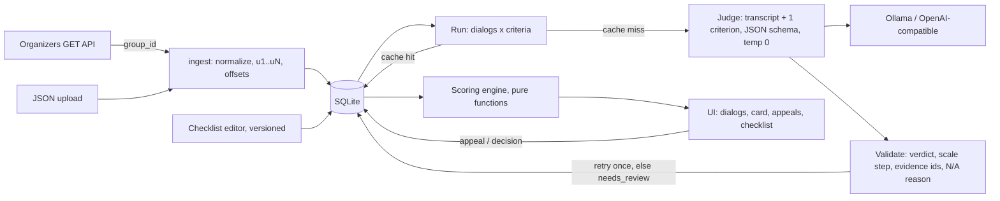

# CQA — Conversation Quality Analytics

Prototype for the Freedom Broker CQA hackathon. It scores how operators handle customer chats and calls
against a configurable checklist, shows the answer, points, weight, explanation and the exact message
behind every criterion, and supports appeals with a reviewer decision and recalculated total.

- **Local LLM judge** (Ollama, default `qwen3:8b`) with an OpenAI-compatible cloud fallback.
- **One model call per (dialog, criterion)**, evidence cited by utterance id and validated on the server.
- **All arithmetic is deterministic Python** (weights, N/A redistribution, rounding), unit-tested.
- **Checklist editable in the UI**, every save is a new version; re-applying re-runs only changed criteria.

## Run (Python 3.11+)

```bash
python -m venv .venv && .venv\Scripts\activate      # macOS/Linux: source .venv/bin/activate
pip install -r requirements.txt
copy .env.example .env                               # macOS/Linux: cp — then fill it in
python -m uvicorn app.main:app --port 8000
```

Open http://localhost:8000. Tests: `python -m pytest -q`.

Local model setup (Ollama on an RTX 4060 laptop): [docs/SETUP_4060.md](docs/SETUP_4060.md).

### Environment (`.env`)

| Variable | Meaning |
|---|---|
| `CQA_API_URL_TEMPLATE` | Organizers' GET link with `{group_id}` in place of the group id. Keep it out of git. |
| `LLM_PROVIDER` | `ollama` (local), `openai` (any OpenAI-compatible API), `fake` (tests/offline UI) |
| `LLM_MODEL` | e.g. `qwen3:8b` |
| `OLLAMA_URL`, `OLLAMA_NUM_CTX`, `OLLAMA_THINK` | Ollama address, context size, thinking mode for qwen3 |
| `OPENAI_BASE_URL`, `OPENAI_API_KEY` | Cloud fallback; the key never leaves the server |
| `LLM_CONCURRENCY`, `LLM_TIMEOUT_S` | Parallel model calls, per-call timeout |
| `CORS_ORIGINS` | Allowed origins for a future Dynamics 365 host |

Provider, model, Ollama address and concurrency can also be changed at runtime in **Настройки**
(stored in the DB), so switching models needs no code change after stop-code.

## Import data and evaluate (all through the UI)

1. **Наборы** → enter `group_id` (e.g. `DEV`, or the control id) → **Загрузить**. The server fetches it (no CORS issues)
   and shows an import report. A JSON file (full API response, array, or one record) can be uploaded instead.
2. **Оценить** next to the set → progress shows done / cache hits / new model calls / needs review.
3. **Диалоги** → open a dialog: transcript on the left, results on the right. Evidence chips jump to the
   message (and seek the call recording). `#/dialog/<id>?u=u12` is a deep link to a message.

## Model and cost

| Model | Where | Cost per evaluation (8 calls) |
|---|---|---|
| `qwen3:8b` (Q4, Ollama) | local RTX 4060 8 GB | **$0** (electricity only) — latency: _fill in after the DEV run_ |

Cost and tokens are logged for every call (`llm_calls` table); **Настройки → Стоимость и надёжность** shows the
average cost per evaluation, tokens per dialog, p50/p95 latency and invalid-output rate. For a paid model, add
its price per 1M tokens to `config/prices.json` and the UI shows real cost.

## How it works



- **Prompt layout**: system rules → transcript with ids `[u7] 00:41 operator: …` → one criterion block (rules,
  answer definitions, scale steps, N/A condition) → JSON. The transcript prefix is identical across criteria,
  so Ollama reuses its KV cache.
- **Output** (reasoning before verdict): `reasoning, verdict, value, evidence_ids, checked_range, na_reason, explanation, confidence`.
  Ollama's structured output constrains verdicts, scale steps and utterance ids to valid values.
- **Validation**: verdict allowed for the criterion, value is a listed step, N/A only when allowed and explained,
  evidence ids exist, a "yes" cites an operator line. On failure: one retry with the error, then `needs_review`
  (shown as «требует проверки», excluded from the total, which is marked provisional).
- **Cache**: `sha256(transcript, criterion + rules, prompt version, provider, model)`. Editing one criterion
  re-runs only that criterion; a new transcript always gets a fresh evaluation.
- **Appeals**: original AI results are never modified. Appeals and decisions are separate records;
  final = reviewer decision if changed, else original; totals are recomputed from final values.

### Scoring rules (from the checklist PDF)

- Да = full weight, Нет = 0; scale criteria proportional to the weight, top step = full weight.
- N/A criteria are excluded and their weight is redistributed proportionally; the maximum stays 100.
- Total rounded to 2 digits (HALF_UP). No applicable weighted criteria → total is not computed.
- Gross errors are a separate flag with no points and do not change the total.

## Validation against human labels

```bash
python -m eval.make_gold        # drafts eval/gold/gold_labels.csv from model results (stratified RU/KZ/EN + calls)
# annotators fix `value` and put their name in `annotator`
python -m eval.run_eval         # accuracy, Cohen's kappa, scale MAE, per-language, total-score error, disagreements
```

To compare models: switch the model in **Настройки**, run DEV again, run `eval.run_eval`. Results for each model
stay cached, so switching back is instant. _Results table: fill in after the bake-off._

## Demo-day runbook

**Before stop-code**: fresh clone → setup → run → load DEV → evaluate → tag the commit.

**At hour 23**: Наборы → control `group_id` → Загрузить → Оценить → wait for progress to finish.

**Criterion swap**: Чек-лист → edit/replace the criterion → **Сохранить версию** → **Применить к набору** → the control
set. Progress shows cache hits for unchanged criteria and new calls only for the changed one.

**Pre-pick demo dialogs**: one with crisp evidence, one with N/A, one with a gross error if any, one call (audio seek).

**Fallback**: results survive restarts (SQLite in `data/`). If the local model fails, switch the provider in
**Настройки** (or `.env` + restart) — not a code change.

## Dynamics 365 adaptation

- `frontend/` is plain HTML/CSS/ES modules with relative paths, no build step and no CDN: upload the files as
  web resources under the publisher prefix.
- Pass the backend address via the `data` parameter (`apiBase=https://…` or `{"apiBase":"https://…"}`), or `?apiBase=`.
- All state lives in the backend, so the control can be reloaded by the form at any time.
- Add the D365 org origin to `CORS_ORIGINS`.

## Known limitations

- Transcript-only judging: tone and diction in calls are not assessed (the checklist has no audio criteria).
- Small local models are weaker in Kazakh; check per-language accuracy in the eval report.
- The gold set is small (15–20 dialogs), so accuracy numbers have wide error bars.

Open questions and interpretations: [docs/OPEN_QUESTIONS.md](docs/OPEN_QUESTIONS.md).
